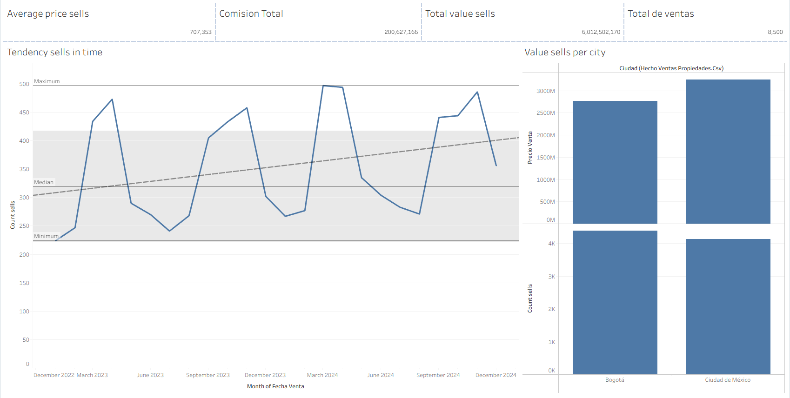

# 🏠 Real Estate Commercial Analysis Dashboard

An executive dashboard that analyzes sales, customers, and properties for a real estate company, built to support data-driven strategic decisions. It covers overall performance, commercial breakdowns, time-based growth, and customer cohort retention.

---

## 🎯 Business Questions Answered

- **Overall performance:** total revenue, properties sold, average sale price, total commission.
- **Commercial analysis:** which property type, customer segment, and sales channel drive the most revenue.
- **Time analysis:** how sales evolve, year-over-year growth, and year-to-date (YTD) performance.
- **Customer cohorts:** do customers come back after their first purchase, and which cohorts generate the most value over time.

---

## 📂 Datasets

| Table | Description |
|---|---|
| `hecho_ventas_propiedades` | Fact table with sales transactions (price, customer, property, channel, date, commission) |
| `dim_clientes` | Customer information and segmentation |
| `dim_propiedades` | Property characteristics (type, size, location) |
| `dim_fecha` | Calendar table (date hierarchy) |

---

## 🧹 Data Preparation

- Converted `fecha_venta` to Date format and fixed numeric fields.
- Formatted `porcentaje_comision` as a percentage.
- Reviewed null values and decided whether to keep or remove them.
- Validated that primary keys in `dim_clientes` and `dim_propiedades` have no duplicates.

## 🧩 Data Model

Star schema with `hecho_ventas_propiedades` as the central fact table, connected to `dim_clientes`, `dim_propiedades`, and `dim_fecha` through one-to-many (1:*) relationships with single-direction filtering.

---

## 📊 Dashboard Pages

### 1. Executive Overview
- Current state of sales and **Total Revenue** (including commission)
- Revenue trend over time
- Key KPIs: Total Revenue, Number of Sales, Average Ticket, Total Commission

### 2. Commercial Analysis
- Sales price, quantity sold, and average revenue per **property type**
- Three participation (%) charts showing revenue share by:
  - **Sales channel**
  - **Buyer segment**
  - **Property type**
- Conditional formatting (traffic-light colors) to highlight top-performing categories

### 3. Growth Over Time (YoY & YTD)
- **Year-over-Year** revenue comparison
- **YTD** chart comparing 2023 vs 2024
- Revenue representation in %
- Line chart for time comparison across periods

### 4. Cohort Analysis
- Cohort matrix: rows = acquisition month, columns = sale month
- Number of sales and sales value per cohort
- Shows repeat purchase behavior after the customer's first purchase

---

## 📐 Key Calculations

- **Base metrics:** Total Revenue, Sales Count, Average Ticket, Total Commission
- **Share of total (%):** revenue participation by property type, channel, and customer segment (filter-context calculations)
- **Time intelligence:** YTD, prior year, and YoY growth
- **Cohort fields:** First Purchase Date, Cohort Month, Sale Month

---

## 💡 Key Insights

> Replace this section with your actual findings from the dashboard.

- Total revenue and number of sales for the analyzed period: _add figures_
- Top property type by revenue: _add_
- Best-performing sales channel: _add_
- Customer segment with highest participation: _add_
- YoY growth: _add_
- Cohort retention highlights: _add_

## ✅ Recommendations

- Prioritize the property types with the highest revenue contribution.
- Strengthen the top sales channel and evaluate how to improve underperforming ones.
- Implement retention strategies to increase repeat purchases in recent cohorts.

---

## 🛠️ Tech Stack & Tags

`Tableau` · `Data Visualization` · `Dashboard Design` · `Star Schema` · `Data Modeling` · `Data Cleaning` · `KPIs` · `Year-over-Year` · `YTD` · `Cohort Analysis` · `Business Intelligence` · `AI-Assisted Analysis`

**AI usage:** an AI assistant (Claude) was used to support documentation, analysis review, and README writing.

---

## 🚀 How to View

1. Open the workbook file in this repository with Tableau Desktop (or Tableau Public).
2. Or view the published dashboard: _add your public link here_.

## 👤 Author

**Jair Alejandro Forero Rodríguez**
Data Analyst Bootcamp project — TripleTen
