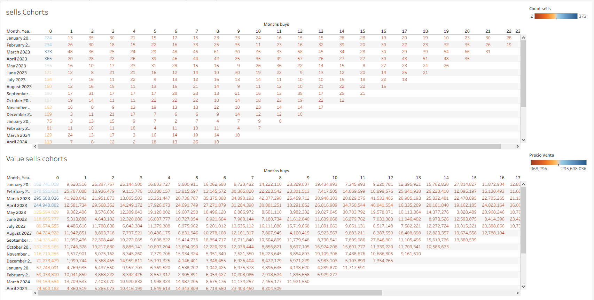

# Which Property Types, Channels, and Customer Segments Drive Real Estate Revenue?

An executive Tableau dashboard that analyzes sales, customers, and properties for a real estate company to show where revenue comes from, how it grows year over year, and whether customers return after their first purchase. **[Main finding with figure: add total revenue, top property type share, and YoY growth]**


## Pregunta de negocio

Management needed data to support strategic decisions on four fronts:

- **Overall performance:** total revenue, properties sold, average sale price, and total commission.
- **Commercial analysis:** which property type, customer segment, and sales channel drive the most revenue.
- **Time analysis:** how sales evolve, year-over-year growth, and year-to-date (YTD) performance.
- **Customer cohorts:** whether customers come back after their first purchase and which cohorts generate the most value over time.

## Datos

- **Source, number of records, and period:** _add_
- **Tables used:**

| Table | Description |
|---|---|
| `hecho_ventas_propiedades` | Fact table with sales transactions (price, customer, property, channel, date, commission) |
| `dim_clientes` | Customer information and segmentation |
| `dim_propiedades` | Property characteristics (type, size, location) |
| `dim_fecha` | Calendar table (date hierarchy) |

## Proceso

**Cleaning and transformation (Excel / CSV)**

- Converted `fecha_venta` to Date format and fixed numeric fields.
- Formatted `porcentaje_comision` as a percentage.
- Reviewed null values and decided whether to keep or remove them.
- Validated that primary keys in `dim_clientes` and `dim_propiedades` have no duplicates.

**Data model**

Star schema with `hecho_ventas_propiedades` as the central fact table, connected to `dim_clientes`, `dim_propiedades`, and `dim_fecha` through one-to-many (1:*) relationships with single-direction filtering.


**Main calculations**

- **Base metrics:** Total Revenue, Sales Count, Average Ticket, Total Commission.
- **Share of total (%):** revenue participation by property type, channel, and customer segment.
- **Time intelligence:** YTD, prior year, and YoY growth.
- **Cohort fields:** First Purchase Date, Cohort Month, Sale Month.

```
// Example calculated field (add your real formula)
Total Revenue = SUM([price]) + SUM([commission])
```

**Dashboard pages**

1. **Executive Overview:** current sales state, revenue trend, and KPIs (Total Revenue, Number of Sales, Average Ticket, Total Commission).
2. **Commercial Analysis:** sales price, quantity sold, and average revenue per property type, plus three participation (%) charts by sales channel, buyer segment, and property type, with traffic-light conditional formatting.

   

3. **Growth Over Time (YoY & YTD):** year-over-year comparison, YTD chart for 2023 vs 2024, and a line chart across periods.

   

4. **Cohort Analysis:** matrix with acquisition month in rows and sale month in columns, showing number of sales and sales value per cohort and repeat purchase behavior.

   

## Hallazgos

1. **[Total revenue and number of sales for the period: add figures]**
2. **[Top property type by revenue and its share: add figure]**
3. **[Best-performing sales channel and customer segment, with share: add figures]**
4. **[YoY growth 2023 vs 2024: add figure]**
5. **[Cohort retention highlight, e.g. repeat purchase rate: add figure]**

## Recomendaciones

- Prioritize the property types with the highest revenue contribution.
- Strengthen the top sales channel and evaluate how to improve underperforming ones.
- Implement retention strategies to increase repeat purchases in recent cohorts.

## Limitaciones

- **[Add: period covered, dataset size, and whether the data is real or synthetic]**
- Commission and revenue figures reflect only the fields in the fact table; costs and margins are not available, so profitability cannot be concluded.
- Cohort results depend on the observation window; recent cohorts have had less time to repurchase.

## Cómo abrirlo

- **Tableau:** open the workbook file in this repository with Tableau Desktop (or Tableau Public).
- **Published dashboard:** _add your public link here_.

## Herramientas

`Tableau` · `Data Visualization` · `Dashboard Design` · `Star Schema` · `Data Modeling` · `Data Cleaning` · `Excel / CSV` · `KPIs` · `Year-over-Year` · `YTD` · `Cohort Analysis` · `Business Intelligence` · `AI-Assisted Analysis`

**AI usage:** an AI assistant (Claude) was used to support documentation, analysis review, and README writing.

## Author

**Jair Alejandro Forero Rodríguez**
Data Analyst Bootcamp project, TripleTen
